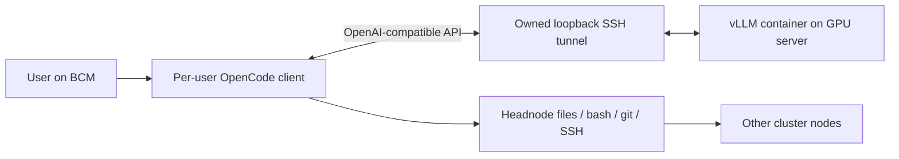

# local-ai

[中文（默认）](README.md)

Containerized GPU inference with per-user OpenCode clients on a BCM headnode.

The GPU server runs the model. The headnode runs OpenCode and its tools: file
edits, shell commands, git, and SSH to other cluster nodes. A client does not need
a local GPU, CUDA, Docker, Node.js, or npm.

[User manual and all commands](docs/en/commands.md) · [Deployment guide](docs/en/deployment.md) · [Architecture](docs/en/architecture.md) ·
[Development](docs/en/development.md) · [Offline deployment](docs/en/offline.md) ·
[Validation](docs/en/validation.md)



## Discover commands

Use `./local-ai --help` for groups, `./local-ai server --help` for server commands, and
`./local-ai server start --help` for options and defaults. See the [complete manual](docs/en/commands.md).

| Entry | Purpose | Run on |
|---|---|---|
| profiles | List hardware presets | Either host |
| image / model | Prepare images and weights | GPU host or preparation machine |
| server | Plan, start, query, stop | GPU001 |
| client | Install, inspect, export native client | bcm-headnode |
| chat | Connect to inference; execute local tools | bcm-headnode |

## Example environment

| Hostname | Role | Commands run here |
|---|---|---|
| `GPU001` | GPU server; an eight-card B300 in this example | Prepare images/weights, manage inference instances, check health |
| `bcm-headnode` | BCM headnode | Log in as `alice`, install the client, use OpenCode in `/home/alice/project` |

Replace these hostnames with your own. The examples assume `alice` can SSH from `bcm-headnode` to `GPU001`.
Instance names `a` and `b` identify services on that GPU server, not hostnames.

## Supported deployment profiles

| Profile | GPU-server CPU / image | Local GPUs | Engram placement | Project validation |
|---|---|---:|---|---|
| `b300-tp4` | AMD64 / `linux/amd64` | 4 B300 | GPU | Hardware settings verified |
| `gb300-tp4` | ARM64 / `linux/arm64` | 4 GB300/B300 | GPU | Experimental; no GB300 hardware test |
| `gb300-tp2` | ARM64 / `linux/arm64` | 2 GB300/B300 | CPU | Upstream-recipe-derived; no hardware test |

A GB300 server's ARM64 architecture does **not** change the BCM client's
architecture. Client assets are selected independently on the headnode.

These are single-host profiles: selected GPUs must be visible to the same OS.
A two-GPU GB300 host cannot use the four-GPU profile by naming GPUs on another
host. This project does not implement multi-node tensor parallelism or an
NVL72-wide scheduler.

The pinned vLLM `0.32.0-ubuntu2404` image is a multi-platform manifest. Both
AMD64 and ARM64 child digests were checked; CPU/image mismatches are rejected.
The model is `deepseek-ai/DeepSeek-V4.1-Flash`, pinned to revision
`314113f8a7dadb388215396ba5fbee2c610a04d6`. It is not silently updated to another variant.

## Prerequisites

**GPU server:** Linux, Python 3.10+, compatible NVIDIA driver, Docker with CDI
support (Docker API 1.49+), NVIDIA Container Toolkit, sufficient local GPUs/HBM/RAM/storage, and an
operator-approved GPU allocation. Known baseline: Ubuntu 24.04, driver
580.126.20, Docker 29.2.1, Toolkit 1.19.1.

**BCM headnode:** Linux AMD64 or ARM64, Python 3.10+, Bash, git, OpenSSH,
ripgrep (`rg`), and util-linux `script`. OpenCode 1.19.5 is installed into the
user's private state directory. Existing SSH login and host-key verification to
the GPU node must work. GitHub/source access is needed only during online setup.

The four-card B300 reference uses about 125.7 GiB/card for weights and about
218 GiB/card including reserved KV/runtime memory. Model files occupy about
510.3 GB once and can be shared read-only between instances. Leave additional
space for images, caches, and offline exports. GB300 TP2 offloads roughly
189 GiB of Engram tables to host RAM, before loading/runtime/OS overhead.
A conservative 256 GiB MemAvailable guard is enforced for that experimental profile;
it is not a measured minimum RAM requirement.

Preparation reuses complete local images/models without repeat downloads. Installation appends to /raid/local-ai/install.log; client installation uses its private asset directory. See the [manual](docs/en/commands.md) for force refresh, journal paths and provenance checks.

## GPU server: prepare and start

The deployment account needs Docker access and write permission to the data directory, configured by the administrator.

Run these commands **on the GPU server**, not on BCM:

Choose these values before running the example:

| Option | Meaning / what to change |
|---|---|
| `--profile b300-tp4` | B300 four-GPU inference preset. TP4 splits one instance across four local GPUs. |
| `--data-dir /raid/local-ai` | Weights, image locks, cache and logs; separate from the Git checkout. Choose a large local directory. |
| `--gpus 0,1,2,3` | Server GPU indices from nvidia-smi, or full UUIDs. Count must match the profile. |
| `--name a` | Instance name, reused for status/stop and its log directory; not a hostname. |
| `--port 18000` | Model HTTP API port, default 18000. Use 18001 for a second instance; this is not the SSH port. |

Server plan/start default to profile b300-tp4 and name a; --gpus is required.
The data directory uses LOCAL_AI_DATA_DIR if set, otherwise /raid/local-ai.
Use the same --data-dir for preparation, planning and startup: options do not carry over between commands.
```bash
git clone https://github.com/junli-nv/local-ai.git
cd local-ai
# List profiles and validation status
./local-ai profiles
docker version
nvidia-ctk cdi list
```

Confirm the Docker daemon is reachable and CDI includes nvidia.com/gpu=GPU-... UUID aliases for selected GPUs.
If the device list is empty, an administrator refreshes definitions on GPU001:

```bash
sudo systemctl restart nvidia-cdi-refresh.service
nvidia-ctk cdi list
```

Without this service, follow the manual CDI guidance in the [deployment guide](docs/en/deployment.md).
After prerequisites pass, prepare artifacts and start:

```bash
# Download the inference container image
./local-ai image pull --profile b300-tp4 --data-dir /raid/local-ai
# Download complete model weights
./local-ai model download --profile b300-tp4 --data-dir /raid/local-ai
# Preview the plan without starting a service
./local-ai server plan --profile b300-tp4 --gpus 0,1,2,3 --name a --data-dir /raid/local-ai
# Start the instance; initial loading takes time
./local-ai server start --profile b300-tp4 --gpus 0,1,2,3 --name a --data-dir /raid/local-ai
curl --fail http://127.0.0.1:18000/health
```

Run on GPU001: 127.0.0.1 means GPU001 itself. A successful /health request (curl exit code 0) means the API is healthy; the body may be empty. While loading, wait and retry; inspect instances/a/server.log.

`server plan` is read-only. `server start` validates weights, native CPU/image
architecture, selected GPU UUIDs, CDI aliases, active processes, assignments, and
the API port. It never kills another workload.

For a GB300 host with four local GPUs, select `--profile gb300-tp4`. With two
local GPUs and sufficient host memory, select `--profile gb300-tp2 --gpus 0,1`.
GB300 profiles require hardware acceptance testing before production.

## BCM headnode: install and chat

Run these commands **on BCM**, as the user who should execute tools:
```bash
git clone https://github.com/junli-nv/local-ai.git
cd local-ai
./local-ai client install
./local-ai client doctor
ssh GPU001 hostname
./local-ai chat --server GPU001 --project /home/alice/project
```

Replace `GPU001` with the actual GPU hostname. `chat` opens an authenticated SSH
tunnel, waits for the model API, launches OpenCode locally, and closes the tunnel
on exit. No headnode Docker daemon or global Python package installation is required.

| Option | Meaning |
|---|---|
| `--server GPU001` | Server SSH hostname, optionally alice@GPU001; replace with a reachable host. |
| `--project /home/alice/project` | Project directory on bcm-headnode; defaults to the current directory, not a server directory. |
| `--port 18001` | Remote model API port; must match the instance. Default: 18000. |

Options:
```bash
./local-ai chat --server alice@GPU001 --port 18001 --project /home/alice/project
./local-ai chat --server GPU001 --check
./local-ai chat --server GPU001 --run 'Use bash to run hostname and report its output.'
```

--check only checks connectivity, without inference. --run executes one quoted prompt and exits; omit it for interactive use.

For an existing tunnel or compatible local proxy, --endpoint selects an API base URL including /v1, instead of --server:
```bash
./local-ai chat --endpoint http://127.0.0.1:28000/v1
```

Tools execute on the **client host** with that user's permissions. Inference
remains in the GPU container. The client receives neither the GPU server's root
credentials nor MyTerm tools automatically.

## Two instances and multiple users

On an eight-card B300 server:
```bash
./local-ai server start --profile b300-tp4 --name a --gpus 0,1,2,3 --port 18000 --data-dir /raid/local-ai
./local-ai server start --profile b300-tp4 --name b --gpus 4,5,6,7 --port 18001 --data-dir /raid/local-ai
```

Instances share only read-only model files; caches, logs, KV, ports, and GPU
assignments are separate. Clients choose an instance with `chat --port`.
There is no automatic load balancer or per-user quota service.

Users share inference, not their OpenCode database or SSH keys. Private client
state defaults to `~/.local/state/local-ai/` (or `$XDG_STATE_HOME/local-ai/`).
Different logical servers/ports have different histories. Concurrent sessions
use separate connection-config files. Four active sequences per engine is a
scheduling limit, not a four-user registration limit; additional work queues.

## Runtime data stays outside git

| Location | Contents |
|---|---|
| GPU `/raid/local-ai/models/` | Pinned weights and model metadata |
| GPU `/raid/local-ai/images/` | Architecture-specific image locks |
| GPU `/raid/local-ai/instances/NAME/` | Spec, args, launch command, cache, full server log |
| BCM private `clients/ARCH/` | Client binary, public cache seed, asset manifest |
| BCM private `services/ID/` | User history/cache and per-session complete logs |

No credentials, binaries, model weights, or chat histories belong in this
repository. See [offline deployment](docs/en/offline.md) for separate client/server
exports, platform selection, integrity checks, and first-start acceptance.

## Developing

Runtime Python code uses the standard library only. Running from the checkout
does not require pip. Optional developer tools go in a project virtualenv:
```bash
python3 -m venv .venv
.venv/bin/python -m pip install -e '.[dev]'
.venv/bin/python -m unittest discover -s tests -v
.venv/bin/ruff check src tests
.venv/bin/ruff format --check src tests
```

Read [the design and development workflow](docs/en/development.md) before adding a
profile, model, endpoint, or runtime option. GitHub Actions runs CPU-only tests;
GPU hardware acceptance is a separate, explicitly documented step.
