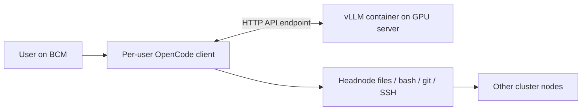

# local-ai

Latest stable version tag: [1.0.0](https://github.com/junli-nv/local-ai/tree/v1.0.0). Use `./local-ai --version` for the project version; OpenCode, model and vLLM versions are selected separately.

[中文（默认）](README.md)

Containerized GPU inference with per-user OpenCode clients on a BCM headnode.

The GPU server runs the model. The headnode runs OpenCode and its tools: file
edits, shell commands, git, and SSH to other cluster nodes. A client does not need
a local GPU, CUDA, Docker, Node.js, or npm.

[User manual and all commands](docs/en/commands.md) · [Deployment guide](docs/en/deployment.md) · [Architecture](docs/en/architecture.md) ·
[Development](docs/en/development.md) · [Developer handoff and decisions](docs/en/development.md#developer-handoff-decisions-and-working-order) · [Offline deployment](docs/en/offline.md) ·
[Validation](docs/en/validation.md)



## Operations and project instructions

local-ai is a daily-work assistant for system diagnosis, scripts and code, file/data
processing, service configuration, and preparing, submitting and tracking Slurm or
Kubernetes jobs. Ask the BCM client to SSH to GPU001 and report its
actual CPU, memory and GPU models and counts. It uses the current account's tools
and SSH access; inference profiles do not restrict which hardware it can inspect.
`--project` selects the working directory. Remote hardware queries do not require
code changes or an inventory fixture.

Repository instructions are in [AGENTS.md](AGENTS.md), with an
[English version](docs/en/contributor-instructions.md) and a
[development guide](docs/en/development.md). The no-probing rule for
`server plan --inventory FILE` applies only to that pure planning feature.
Each new `chat` session loads built-in operations guidance. Restart the client
session after updating the code; the inference server does not need a restart.
The session log directory contains `operations.md`, referenced by `instructions`
in `opencode.json`. Report specific tool permission, authentication or network
failures rather than claiming that the project prohibits hardware queries.

## Discover commands

Use `./local-ai --help` for groups, `./local-ai server --help` for server commands, and
`./local-ai server start --help` for options and defaults. See the [complete manual](docs/en/commands.md).

| Entry | Purpose | Run on |
|---|---|---|
| profiles | List hardware presets | Either host |
| image / model | Prepare images and weights | GPU host or preparation machine |
| server | Plan, start, query, stop | GPU001 |
| client | Install or export native client | bcm-headnode |
| chat | Connect to inference; execute local tools | bcm-headnode |

## Example environment

| Hostname | Role | Commands run here |
|---|---|---|
| `GPU001` | GPU server; an eight-card B300 in this example | Prepare images/weights, manage inference instances, check health |
| `bcm-headnode` | BCM headnode | Log in as `alice`, install the client, use OpenCode in `/home/alice/project` |

Replace these hostnames with your own. The examples assume BCM can reach the model API port on GPU001.
Instance names `a` and `b` identify services on that GPU server, not hostnames.

## Supported deployment profiles

| Profile | GPU-server CPU / image | Local GPUs | Engram placement | Project validation |
|---|---|---:|---|---|
| `b300-tp4` | AMD64 / `linux/amd64` | 4 B300 | GPU | Hardware settings verified |
| `gb300-tp4` | ARM64 / `linux/arm64` | 4 GB300/B300 | GPU | Experimental; no GB300 hardware test |
| `gb300-tp2` | ARM64 / `linux/arm64` | 2 GB300/B300 | CPU | Upstream-recipe-derived; no hardware test |

A GB300 server's ARM64 architecture does **not** change the BCM client's
architecture. Client assets are selected independently on the headnode.

These are single-host profiles: selected GPUs must be visible to the same OS.
A two-GPU GB300 host cannot use the four-GPU profile by naming GPUs on another
host. This project does not implement multi-node tensor parallelism or an
NVL72-wide scheduler.

The pinned vLLM `0.32.0-ubuntu2404` image is a multi-platform manifest. Both
AMD64 and ARM64 child digests were checked; CPU/image mismatches are rejected.
The default recipe uses `deepseek-ai/DeepSeek-V4.1-Flash`, pinned to revision
`314113f8a7dadb388215396ba5fbee2c610a04d6`. It is not silently updated to another variant. Select external recipes with LOCAL_AI_CATALOG; see [model and client compatibility](docs/en/development.md#model-and-client-compatibility).

## Prerequisites

**GPU server:** Linux, Python 3.10+, compatible NVIDIA driver, Docker with CDI
support (Docker API 1.49+), NVIDIA Container Toolkit, sufficient local GPUs/HBM/RAM/storage, and an
operator-approved GPU allocation. Known baseline: Ubuntu 24.04, driver
580.126.20, Docker 29.2.1, Toolkit 1.19.1.

**BCM headnode:** Linux AMD64 or ARM64, Python 3.10+, Bash, git,
ripgrep (`rg`), and util-linux `script`. OpenCode public binaries are installed under clients/ in this directory; personal state remains private. The model API must be reachable from BCM. Install SSH only if onward tool tasks need it. GitHub/source access is needed only during online setup.

The four-card B300 reference uses about 125.7 GiB/card for weights and about
218 GiB/card including reserved KV/runtime memory. Model files occupy about
510.3 GB once and can be shared read-only between instances. Leave additional
space for images, caches, and offline exports. GB300 TP2 offloads roughly
189 GiB of Engram tables to host RAM, before loading/runtime/OS overhead.
A conservative 256 GiB MemAvailable guard is enforced for that experimental profile;
it is not a measured minimum RAM requirement.

Preparation reuses complete local images/models without repeat downloads. Installation appends to /raid/local-ai/install.log; client installation uses its private asset directory. See the [manual](docs/en/commands.md) for force refresh, journal paths and provenance checks.

## GPU server: prepare and start

The deployment account needs Docker access and write permission to the data directory, configured by the administrator.

Run these commands **on the GPU server**, not on BCM:

Choose these values before running the example:

| Option | Meaning / what to change |
|---|---|
| `--profile b300-tp4` | B300 four-GPU inference preset. TP4 splits one instance across four local GPUs. |
| `--data-dir /raid/local-ai` | Runtime data root for models, image locks, caches, instances and logs. Defaults to the unpacked directory; src/ holds source and local-ai is a launcher file. |
| `--gpus 0,1,2,3` | Server GPU indices from nvidia-smi, or full UUIDs. Count must match the profile. |
| `--name a` | Instance name, reused for status/stop and its log directory; not a hostname. |
| `--port 18000` | Model HTTP API port, default 18000. Use 18001 for a second instance. |

Server plan/start default to profile b300-tp4 and name a; --gpus is required.
The data directory uses LOCAL_AI_DATA_DIR if set, otherwise the program's unpacked directory (/raid/local-ai here).
Use the same --data-dir for preparation, planning and startup: options do not carry over between commands.
Download the complete program from GitHub into a new empty /raid/local-ai. The unpacked directory is the installation. Preserve custom source changes before updating legacy installations. Defaults follow the program location, including after renaming. The example account needs sudo/Docker access; root may omit sudo.

```bash
sudo install -d -o "$(id -u)" -g "$(id -g)" /raid/local-ai
curl -fL --retry 3 https://github.com/junli-nv/local-ai/archive/refs/heads/main.tar.gz -o /tmp/local-ai-source.tar.gz
tar -xzf /tmp/local-ai-source.tar.gz --strip-components=1 -C /raid/local-ai
cd /raid/local-ai
./local-ai --version
# List profiles and validation status
./local-ai profiles
docker version
docker info --format 'Server={{.ServerVersion}} Driver={{.Driver}} Root={{.DockerRootDir}}'
docker ps -a
nvidia-ctk cdi list
```

Confirm the Docker daemon is reachable and CDI includes nvidia.com/gpu=GPU-... UUID aliases for selected GPUs.
If the device list is empty, an administrator refreshes definitions on GPU001:

```bash
sudo systemctl restart nvidia-cdi-refresh.service
nvidia-ctk cdi list
```

Without this service, follow the manual CDI guidance in the [deployment guide](docs/en/deployment.md).
### Storage checks and recovery before downloading

The `docker version` and `docker info` commands above must reach the daemon.
An active service does not prove image storage works. A first inspection reporting
`No such image` is expected and triggers a download; diagnose a failed pull using
the terminal's `Docker error` and the installation journal.

`--data-dir` does not change Docker/containerd image storage. Never delete or move
`/var/lib/docker` or `/var/lib/containerd` while services are running, or share these
databases between nodes.

**Use the following recovery only for a failed pull; skip it for a normal installation.**
If the error contains `failed to prepare extraction snapshot` and
`/var/lib/containerd/io.containerd.snapshotter.v1.overlayfs/metadata.db: no such file or directory`,
have an administrator check original storage, mounts and configuration first.
Restore original storage if it contains data that must be retained. Services may
still hold deleted database files open; restarting Docker alone does not restart
the independent containerd service.

Inspect containers and every containerd namespace before restarting. Arrange maintenance
if tasks or other runtime users could be affected:

```bash
docker ps -a
sudo ctr namespaces list
for ns in $(sudo ctr namespaces list -q); do
    sudo ctr --namespace "$ns" tasks list
    sudo ctr --namespace "$ns" containers list
done
```

Once interruption is acceptable and original storage need not be restored, run
**on the GPU server**; root may omit sudo:

```bash
sudo systemctl stop docker.service docker.socket
sudo systemctl restart containerd.service
sudo systemctl start docker.socket docker.service
docker info
```

Restarting does not restore lost images, containers or volumes. `metadata.db` may only
be created on the first snapshot creation; its absence immediately after restart is
not a failure. Never manually `touch` it. Retry the image pull below and accept recovery
only after successful download and extraction, before downloading weights or starting
inference. If it still fails, stop installation and inspect `/raid/local-ai/install.log`
and `journalctl -u containerd -u docker`.
See the [storage recovery details](docs/en/deployment.md).

### Download artifacts and start

After prerequisites pass, prepare artifacts and start:

```bash
./local-ai install --role server --profile b300-tp4
# Preview the plan without starting a service
./local-ai server plan --host 0.0.0.0 --profile b300-tp4 --gpus 0,1,2,3 --name a --data-dir /raid/local-ai
# Start the instance; initial loading takes time
./local-ai server start --host 0.0.0.0 --profile b300-tp4 --gpus 0,1,2,3 --name a --data-dir /raid/local-ai
./local-ai server status --name a
```

On GPU001, server status --name a prints READY or NOT READY. Server start waits up to 600 seconds by default and records a timestamped READY confirmation in the terminal and instance server.log. Timeout or container exit is explicitly reported.

`server plan` is read-only. `server start` validates weights, native CPU/image
architecture, selected GPU UUIDs, CDI aliases, active processes, assignments, and
the API port. It never kills another workload.

For a GB300 host with four local GPUs, select `--profile gb300-tp4`. With two
local GPUs and sufficient host memory, select `--profile gb300-tp2 --gpus 0,1`.
GB300 profiles require hardware acceptance testing before production.

### Explicit readiness results

Server start waits for API readiness by default, up to 600 seconds. During loading,
compilation and warmup it explicitly reports NOT READY, the runtime log and a
copyable tail -f command. An open TCP port is not sufficient: the container must
still be running and /health must return HTTP 200. Success displays:

```text
服务已就绪（READY）： http://127.0.0.1:18000/health，HTTP 200
```

The same timestamped `[local-ai] ... (READY)` confirmation is appended to
/raid/local-ai/instances/a/server.log. install.log records installation/management;
the instance server.log records model loading, compilation and warmup.
Paths follow --data-dir and the instance name.

Query the current result **on the GPU server**:

```bash
./local-ai server status --name a
```

READY exits 0. NOT READY exits 1 and explains whether the port is closed, the API
is unavailable or the container is stopped. Status is read-only; a past READY
log entry is not a guarantee of current health. Human-readable messages go to
stderr; stdout remains JSON with a ready field.

Use --wait-timeout 1200 on start if needed. Timeout reports NOT READY, exits 1
and leaves the container intact. Inspect logs and query status before restarting.
A container exit reports FAILED. Ctrl+C cancels waiting with exit 130 and leaves
the container running. Use status afterward; re-run start with identical arguments
to wait and record readiness without restarting a matching running instance.
Following the runtime log from another terminal shows detailed progress;
Ctrl+C there only stops log viewing.

### Listen address and existing instances

The server commands above use --host 0.0.0.0 for all IPv4 interfaces. BCM connects
to the host IP or hostname. A specific local IPv4 address is also supported.
Omitting --host keeps the 127.0.0.1 default, suitable for local access or an
administrator-managed proxy. local-ai does not manage network forwarding.

Allow BCM to reach the API port and restrict access to trusted clients; API keys
and HTTPS are not configured here. To change an existing instance, first confirm
the instance to replace, then stop/remove its container and run the start above:

```bash
./local-ai server stop --name a --data-dir /raid/local-ai
docker rm local-ai-a
```

Restarting the original container does not change its arguments. Use 0.0.0.0 only
as a listen address, never as the client endpoint. Specific IP listeners return
a health URL using that IP.

## BCM headnode: install and chat

Run **on BCM** as the user who will execute tools:

```bash
sudo install -d -o "$(id -u)" -g "$(id -g)" /raid/local-ai
curl -fL --retry 3 https://github.com/junli-nv/local-ai/archive/refs/heads/main.tar.gz -o /tmp/local-ai-source.tar.gz
tar -xzf /tmp/local-ai-source.tar.gz --strip-components=1 -C /raid/local-ai
cd /raid/local-ai
./local-ai --version
./local-ai install --role client --endpoint http://GPU001:18000/v1
./local-ai chat --project /home/alice/project
```

Replace GPU001 with a hostname BCM can resolve or the reachable GPU host IP.
Choose an existing BCM project directory. The client checks the API and runs
OpenCode locally. Files, shell, git and other tools execute on BCM with the
current user's permissions; inference runs on the GPU server.

| Option | Meaning |
|---|---|
| --endpoint http://GPU001:18000/v1 | Required reachable HTTP(S) API base, including port and /v1 |
| --project /home/alice/project | Existing BCM project directory; default current directory |
| --check | Check API/model readiness without generating a response |
| --run 'task' | Run one task and exit; omit for interactive use |

```bash
./local-ai chat --endpoint http://GPU001:18000/v1 --check
./local-ai chat --endpoint http://GPU001:18001/v1 --project /home/alice/project
./local-ai chat --endpoint http://GPU001:18000/v1 --run 'Use bash to run hostname and report its output.'
```

Private history is keyed by endpoint; change the port in the URL to choose an
instance. Old history directories keyed by SSH targets remain untouched and
are not automatically mapped to API endpoints.

If forwarding or a reverse proxy is needed, configure it separately with tools
such as frp or nginx, then supply its reachable URL as --endpoint. GPU-node SSH
login is not required for model access. Add the server to NO_PROXY/no_proxy if
proxy environment settings affect internal requests. BCM needs no Docker, CUDA,
Node.js or npm.

### Resume, clipboard and version selection

Run the exit hint `opencode -s ses_...` to restore the original endpoint, project
and chat history. The first chat creates `~/.local/bin/opencode` for resume and
reports PATH or name conflicts. Explicit alternatives are `chat --session ID`
and `chat --continue`. Mouse capture and built-in clipboard shortcuts are
disabled by default; use terminal selection/copy/paste and keyboard navigation.
Use `/export` for long transcripts.

The default OpenCode download version is a validation reference. Choose another
with `client install --version X.Y.Z` or --binary; there is no runtime version
allowlist. Validate actual interfaces and back up history before upgrading.
Local installations and offline exports avoid reliance on a permanent download
source. See the [manual](docs/en/commands.md#resume-and-terminal-clipboard).

## Two instances and multiple users

On an eight-card B300 server:
```bash
./local-ai server start --host 0.0.0.0 --profile b300-tp4 --name a --gpus 0,1,2,3 --port 18000 --data-dir /raid/local-ai
./local-ai server start --host 0.0.0.0 --profile b300-tp4 --name b --gpus 4,5,6,7 --port 18001 --data-dir /raid/local-ai
```

Instances share only read-only model files; caches, logs, KV, ports, and GPU
assignments are separate. Clients choose an instance using the API port in the --endpoint URL.
There is no automatic load balancer or per-user quota service.

Users share inference while retaining private OpenCode databases and tool credentials. Private client
state defaults to `~/.local/state/local-ai/` (or `$XDG_STATE_HOME/local-ai/`).
Different logical servers/ports have different histories. Concurrent sessions
use separate connection-config files. Four active sequences per engine is a
scheduling limit, not a four-user registration limit; additional work queues.

## Runtime data stays outside git

| Location | Contents |
|---|---|
| `/raid/local-ai/local-ai` | Launcher file |
| `/raid/local-ai/src/`, `docs/` | Complete source and manuals |
| `/raid/local-ai/clients/` | Public native client assets by CPU architecture |
| `/raid/local-ai/dist/` | Complete offline packages and SHA256 checksums |
| GPU `/raid/local-ai/models/` | Pinned weights and model metadata |
| GPU `/raid/local-ai/images/` | Portable image archives and architecture-specific locks |
| GPU `/raid/local-ai/instances/NAME/` | Spec, args, launch command, cache, full server log |
| BCM private `services/ID/` | User history/cache and per-session complete logs |

No credentials, binaries, model weights, or chat histories belong in this
repository. See [offline deployment: installed-environment migration or online preparation](docs/en/offline.md) for separate client/server
exports, platform selection, integrity checks, and first-start acceptance.

## Developing

Runtime Python code uses the standard library only. Running from the checkout
does not require pip. Optional developer tools go in a project virtualenv:
```bash
python3 -m venv .venv
.venv/bin/python -m pip install -e '.[dev]'
.venv/bin/python -m unittest discover -s tests -v
.venv/bin/ruff check src tests
.venv/bin/ruff format --check src tests
```

Read [the design and development workflow](docs/en/development.md) before adding a
profile, model, endpoint, or runtime option. GitHub Actions runs CPU-only tests;
GPU hardware acceptance is a separate, explicitly documented step.

## Export the complete directory

After installation, export program, image archives, models, clients and portable configuration together. Carry the two files in dist/. dist/ itself is excluded. Verify/extract on the new host and run install --offline before choosing its GPUs and endpoint. These instructions download main with directory-based installation; older v1.0.0 lacks these new commands.

```bash
cd /raid/local-ai
./local-ai export
ls -lh dist/local-ai.tar dist/local-ai.tar.sha256
```
