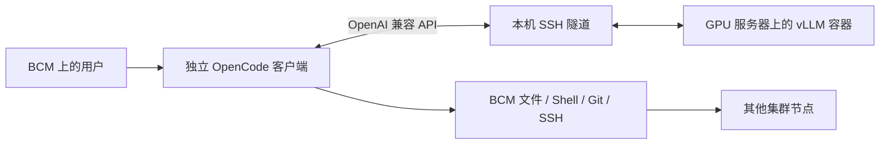

# local-ai

在 GPU 服务器上运行容器化推理服务，在 BCM 头节点上运行每位用户自己的 OpenCode 客户端。

GPU 服务器负责模型推理；BCM 客户端负责文件编辑、Shell、Git 和到其他集群节点的 SSH。
客户端不需要本地 GPU、CUDA、Docker、Node.js 或 npm。

[部署指南](docs/deployment.zh-CN.md) · [架构设计](docs/architecture.md) ·
[开发指南](docs/development.md) · [离线部署](docs/offline.md) · [验证记录](docs/validation.md)



## 平台与验证状态

| 配置 | 服务端 CPU / 镜像平台 | 本机 GPU 数 | Engram 存放位置 | 验证状态 |
|---|---|---:|---|---|
| `b300-tp4` | AMD64 / `linux/amd64` | 4 张 B300 | GPU | 已实机验证 |
| `gb300-tp4` | ARM64 / `linux/arm64` | 4 张 GB300/B300 | GPU | 实验配置，尚未实机验证 |
| `gb300-tp2` | ARM64 / `linux/arm64` | 2 张 GB300/B300 | CPU | 依据上游配方，尚未实机验证 |

**服务端和客户端的架构独立选择。** GB300 服务端使用 ARM64，不代表 BCM 客户端也要使用 ARM64。

这些配置仅支持同一 OS 可见的本地 GPU。两卡 GB300 主机不能通过填写其他主机的 GPU 编号使用四卡配置。
当前不提供跨主机张量并行或整柜 NVL72 调度。

固定的 vLLM `0.32.0-ubuntu2404` 镜像同时提供 AMD64 和 ARM64 版本，配置记录了清单及各平台摘要，
启动前检查 CPU 与镜像是否匹配。模型固定为 `deepseek-ai/DeepSeek-V4.1-Flash`，
revision 为 `314113f8a7dadb388215396ba5fbee2c610a04d6`，不会自动更换模型变体。

## 环境要求

**GPU 服务器：** Linux、Python 3.10+、兼容的 NVIDIA 驱动、支持 CDI 且 API 至少为 1.49 的 Docker、
NVIDIA Container Toolkit，以及足够的 GPU 显存、主存和磁盘。使用前须取得 GPU 资源分配。
已验证基线为 Ubuntu 24.04、驱动 580.126.20、Docker 29.2.1、Toolkit 1.19.1。

**BCM 头节点：** Linux AMD64 或 ARM64、Python 3.10+、Bash、Git、OpenSSH、ripgrep（`rg`）
和 util-linux 的 `script`。OpenCode 1.19.5 安装在当前用户的私有目录。
应先完成 GPU 节点的 SSH 登录和主机密钥确认。在线准备阶段才需要访问代码与软件下载源。

B300 四卡参考配置的权重约占 125.7 GiB/卡，包含预留 KV 缓存及运行开销后约占 218 GiB/卡。
模型文件约 510.3 GB，可供多个实例只读共享；还需预留镜像、缓存和离线导出的空间。
GB300 TP2 的 Engram offload 本身约占 189 GiB 主存，另需加载和系统空间。
该实验配置检查 `MemAvailable` 至少 256 GiB；这是保守保护值，不是实测最低需求。

## GPU 服务器：准备并启动

以下命令在 **GPU 服务器** 执行：

```bash
git clone https://github.com/junli-nv/local-ai.git
cd local-ai
./local-ai profiles
./local-ai image pull --profile b300-tp4 --data-dir /raid/local-ai
./local-ai model download --profile b300-tp4 --data-dir /raid/local-ai
./local-ai server plan --profile b300-tp4 --gpus 0,1,2,3 --name a
./local-ai server start --profile b300-tp4 --gpus 0,1,2,3 --name a
curl --fail http://127.0.0.1:18000/health
```

`server plan` 只生成计划。`server start` 检查权重、CPU/镜像平台、GPU UUID、CDI、
GPU 进程占用、实例分配和端口，不会终止其他作业或修改 Slurm。

四卡 GB300 使用 `--profile gb300-tp4`；两卡 GB300 使用 `--profile gb300-tp2 --gpus 0,1`。
GB300 配置用于生产前须完成实机验收。容器处于 running 状态不代表 API 已就绪。

## BCM 头节点：安装并聊天

以下命令在 **BCM** 执行，使用实际需要执行工具的用户账户：

```bash
git clone https://github.com/junli-nv/local-ai.git
cd local-ai
./local-ai client install
./local-ai client doctor
ssh gpu-a hostname
./local-ai chat --server gpu-a --project /path/to/project
```

将 `gpu-a` 替换为实际服务节点。客户端自动建立 SSH 隧道、检查 API、在 BCM 启动 OpenCode，
退出时关闭隧道。不需要在头节点运行 Docker，也不需要向系统 Python 安装项目依赖。

常用选项：

```bash
./local-ai chat --server user@gpu-a --port 18001 --project /path/to/project
./local-ai chat --server gpu-a --check
./local-ai chat --server gpu-a --run 'Use bash to run hostname and report its output.'
```

已有隧道或本地兼容代理时，可直接指定 API：

```bash
./local-ai chat --endpoint http://127.0.0.1:28000/v1
```

工具在 **客户端所在主机** 上执行，使用当前用户权限。推理仍在 GPU 容器中；
客户端不会自动获得 GPU 服务端的 root 凭据或 MyTerm 工具。

## 单机双实例与多人使用

八卡 B300 可部署两套独立服务：

```bash
./local-ai server start --profile b300-tp4 --name a --gpus 0,1,2,3 --port 18000
./local-ai server start --profile b300-tp4 --name b --gpus 4,5,6,7 --port 18001
```

两套服务只共享只读权重，GPU、显存、KV、端口、缓存和日志分别独立。
客户端通过 `chat --port` 选择实例；当前不提供自动负载均衡或用户配额服务。

多人共享推理服务，各自保留会话数据库和 SSH 凭据。
默认私有状态目录为 `~/.local/state/local-ai/`，也可使用 `$XDG_STATE_HOME/local-ai/`。
不同逻辑服务/端口使用不同历史记录，每次连接配置单独保存。
每引擎四个活动序列是调度上限，不是只能有四名用户；更多请求会排队。

## 运行数据与源码分开

| 位置 | 内容 |
|---|---|
| GPU `/raid/local-ai/models/` | 固定模型权重及元数据 |
| GPU `/raid/local-ai/images/` | 按 CPU 架构保存的镜像锁定信息 |
| GPU `/raid/local-ai/instances/NAME/` | 实例配置、参数、启动命令、缓存及完整服务日志 |
| BCM 私有 `clients/ARCH/` | 客户端程序、公共缓存种子及资源清单 |
| BCM 私有 `services/ID/` | 用户历史、缓存及每次会话完整日志 |

凭据、二进制、模型权重和聊天历史不进入 Git。
离线时分别携带源码、服务端资源和 BCM 客户端资源，具体步骤见 [离线部署](docs/offline.md)。

## 开发与扩展

运行时仅依赖 Python 标准库，从源码目录运行不需要 pip。
可选开发工具安装在项目虚拟环境中：

```bash
python3 -m venv .venv
.venv/bin/python -m pip install -e '.[dev]'
.venv/bin/python -m unittest discover -s tests -v
.venv/bin/ruff check src tests
.venv/bin/ruff format --check src tests
```

新增硬件配置、模型或参数前，请阅读 [开发指南](docs/development.md)。
GitHub Actions 运行 CPU 单元测试；GPU 实机验收单独执行并记录。

---

英文版本：[English README](README.en.md) · [Deployment](docs/en/deployment.md) · [Architecture](docs/en/architecture.md) ·
[Development](docs/en/development.md) · [Offline deployment](docs/en/offline.md) ·
[Validation](docs/en/validation.md)
