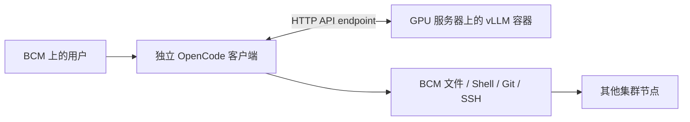

# local-ai

在 GPU 服务器上运行容器化推理服务，在 BCM 头节点上运行每位用户自己的 OpenCode 客户端。

GPU 服务器负责模型推理；BCM 客户端负责文件编辑、Shell、Git 和到其他集群节点的 SSH。
客户端不需要本地 GPU、CUDA、Docker、Node.js 或 npm。

[使用手册与全部命令](docs/commands.md) · [部署指南](docs/deployment.zh-CN.md) · [架构设计](docs/architecture.md) ·
[开发指南](docs/development.md) · [离线部署](docs/offline.md) · [验证记录](docs/validation.md)



## 命令从哪里查

先用 `./local-ai --help` 看入口；用 `./local-ai server --help` 看服务端命令；
用 `./local-ai server start --help` 查具体参数和默认值。完整说明见[使用手册](docs/commands.md)。

| 入口 | 主要用途 | 执行位置 |
|---|---|---|
| `profiles` | 查看可用硬件配置 | 任意一端 |
| `image` / `model` | 准备镜像和权重 | GPU 节点或联网准备机 |
| `server` | 预览、启动、查询、停止实例 | GPU001 |
| `client` | 安装、导出原生客户端 | bcm-headnode |
| `chat` | 连接模型并执行本地工具 | bcm-headnode |

## 本文示例环境

| 主机名 | 角色 | 在这台机器上执行什么 |
|---|---|---|
| `GPU001` | GPU 服务节点，示例为 8 卡 B300 | 下载镜像和权重、启动或停止推理服务、检查健康状态 |
| `bcm-headnode` | BCM 头节点 | 以 `alice` 登录，安装客户端，在 `/home/alice/project` 中运行 OpenCode |

将这两个主机名替换为实际环境。示例假设 `bcm-headnode` 能访问 `GPU001` 的模型 API 端口。
实例 `a`、`b` 是同一 GPU 节点上的服务名字，不是主机名。

## 平台与验证状态

| 配置 | 服务端 CPU / 镜像平台 | 本机 GPU 数 | Engram 存放位置 | 验证状态 |
|---|---|---:|---|---|
| `b300-tp4` | AMD64 / `linux/amd64` | 4 张 B300 | GPU | 已实机验证 |
| `gb300-tp4` | ARM64 / `linux/arm64` | 4 张 GB300/B300 | GPU | 实验配置，尚未实机验证 |
| `gb300-tp2` | ARM64 / `linux/arm64` | 2 张 GB300/B300 | CPU | 依据上游配方，尚未实机验证 |

**服务端和客户端的架构独立选择。** GB300 服务端使用 ARM64，不代表 BCM 客户端也要使用 ARM64。

这些配置仅支持同一 OS 可见的本地 GPU。两卡 GB300 主机不能通过填写其他主机的 GPU 编号使用四卡配置。
当前不提供跨主机张量并行或整柜 NVL72 调度。

固定的 vLLM `0.32.0-ubuntu2404` 镜像同时提供 AMD64 和 ARM64 版本，配置记录了清单及各平台摘要，
启动前检查 CPU 与镜像是否匹配。模型固定为 `deepseek-ai/DeepSeek-V4.1-Flash`，
revision 为 `314113f8a7dadb388215396ba5fbee2c610a04d6`，不会自动更换模型变体。

## 环境要求

**GPU 服务器：** Linux、Python 3.10+、兼容的 NVIDIA 驱动、支持 CDI 且 API 至少为 1.49 的 Docker、
NVIDIA Container Toolkit，以及足够的 GPU 显存、主存和磁盘。使用前须取得 GPU 资源分配。
已验证基线为 Ubuntu 24.04、驱动 580.126.20、Docker 29.2.1、Toolkit 1.19.1。

**BCM 头节点：** Linux AMD64 或 ARM64、Python 3.10+、Bash、Git、ripgrep（`rg`）
和 util-linux 的 `script`。OpenCode 1.19.5 安装在当前用户的私有目录。
BCM 须能访问模型 API；仅在工具任务需要 SSH 访问其他节点时另行准备 OpenSSH。在线准备阶段才需要访问代码与软件下载源。

B300 四卡参考配置的权重约占 125.7 GiB/卡，包含预留 KV 缓存及运行开销后约占 218 GiB/卡。
模型文件约 510.3 GB，可供多个实例只读共享；还需预留镜像、缓存和离线导出的空间。
GB300 TP2 的 Engram offload 本身约占 189 GiB 主存，另需加载和系统空间。
该实验配置检查 `MemAvailable` 至少 256 GiB；这是保守保护值，不是实测最低需求。

准备命令优先复用完整本地镜像和模型，不重复联网下载。安装过程统一追加到 `/raid/local-ai/install.log`；客户端安装日志在其私有程序目录。强制刷新、指定日志路径及版本校验规则见[使用手册](docs/commands.md)。

## GPU 服务器：准备并启动

部署账户须能运行 Docker 并写入所选数据目录；这些权限由管理员预先配置。

以下命令在 **GPU 服务器** 执行。先选好本机 GPU 和数据目录：

示例使用以下参数；换机器部署时，主要调整配置、GPU 和数据目录：

| 参数 | 示例含义 / 如何修改 |
|---|---|
| `--profile b300-tp4` | 使用 B300 四卡推理配置；TP4 表示同一实例跨 4 张本机 GPU。其他平台按上表选择。 |
| `--data-dir /raid/local-ai` | 存放权重、镜像锁文件、缓存和日志；不是 Git 源码目录。可改为容量足够的本地目录。 |
| `--gpus 0,1,2,3` | 使用服务端 `nvidia-smi` 显示的这 4 张卡；也可写完整 GPU UUID。数量须匹配配置。 |
| `--name a` | 自定义实例名，用于区分容器与日志；查询、停止时沿用同一个名字。 |
| `--port 18000` | 模型 HTTP API 端口，默认 18000；第二个实例换成 18001。 |

`server plan/start` 默认配置为 `b300-tp4`，实例名默认 `a`，但必须显式指定 `--gpus`。
数据目录默认取环境变量 `LOCAL_AI_DATA_DIR`，未设置时为 `/raid/local-ai`。
若修改目录，下载、计划和启动时须使用同一个 `--data-dir`，参数不会由前一条命令自动继承。

```bash
git clone https://github.com/junli-nv/local-ai.git
cd local-ai
# 查看配置及验证状态
./local-ai profiles
docker version
docker info --format 'Server={{.ServerVersion}} Driver={{.Driver}} Root={{.DockerRootDir}}'
docker ps -a
nvidia-ctk cdi list
```

先确认 Docker 服务可访问，CDI 列表包含选中 GPU 的 `nvidia.com/gpu=GPU-...` UUID 别名。
若设备列表为空，管理员在 GPU001 刷新定义后再检查：

```bash
sudo systemctl restart nvidia-cdi-refresh.service
nvidia-ctk cdi list
```

没有该服务时使用[部署指南](docs/deployment.zh-CN.md)中的 CDI 手动生成指引。
### 下载前检查与故障恢复

上面的 `docker version` 和 `docker info` 必须能访问服务端。Docker 显示 active
只说明进程运行，不能证明镜像存储正常。首次检查出现 `No such image` 属正常情况，
程序会继续下载；若随后拉取失败，应看终端的 `Docker error` 和安装日志。

`--data-dir` 不改变 Docker/containerd 的镜像存储路径。不要在服务运行时删除或
移动 `/var/lib/docker`、`/var/lib/containerd`，也不要让多节点共享这些数据库。

**仅在拉取报错时执行以下排障，正常安装跳过。** 若看到
`failed to prepare extraction snapshot`，并提示
`/var/lib/containerd/io.containerd.snapshotter.v1.overlayfs/metadata.db: no such file or directory`，
先让管理员检查原存储、挂载和配置；有需保留的数据时先恢复原存储。
运行中的服务可能仍持有已删除的数据库句柄，仅重启 Docker 不会重启独立的 containerd。

重启前检查容器和 containerd 的所有命名空间；有任务或其他用户使用运行时时先安排维护：

```bash
docker ps -a
sudo ctr namespaces list
for ns in $(sudo ctr namespaces list -q); do
    sudo ctr --namespace "$ns" tasks list
    sudo ctr --namespace "$ns" containers list
done
```

确认允许中断服务且原存储无需恢复后，在 **GPU 服务器**执行；root 可省略 sudo：

```bash
sudo systemctl stop docker.service docker.socket
sudo systemctl restart containerd.service
sudo systemctl start docker.socket docker.service
docker info
```

重启不会恢复已丢失的镜像、容器或卷数据。`metadata.db` 可能在首次创建快照时才生成，
重启后立即找不到它不代表失败，也不要手工 `touch`。重试下方镜像下载，以实际拉取和
解包成功验收；成功后再下载模型和启动服务。仍失败时停止后续安装，检查
`/raid/local-ai/install.log` 和 `journalctl -u containerd -u docker`，
详见[部署指南的存储恢复说明](docs/deployment.zh-CN.md)。

### 下载模型并启动服务

确认前置条件后，再下载和启动：

```bash
# 下载推理容器镜像
./local-ai image pull --profile b300-tp4 --data-dir /raid/local-ai
# 下载完整模型权重
./local-ai model download --profile b300-tp4 --data-dir /raid/local-ai
# 预览计划，不启动服务
./local-ai server plan --host 0.0.0.0 --profile b300-tp4 --gpus 0,1,2,3 --name a --data-dir /raid/local-ai
# 启动实例，首次加载需等待
./local-ai server start --host 0.0.0.0 --profile b300-tp4 --gpus 0,1,2,3 --name a --data-dir /raid/local-ai
curl --fail http://127.0.0.1:18000/health
```

在 `GPU001` 执行：`127.0.0.1` 指 GPU001 本机。`/health` 请求成功且 curl 退出码为 0 表示 API 健康；可能没有正文。若仍在加载，等待后重试，并查看 `instances/a/server.log`。

`server plan` 只生成计划。`server start` 检查权重、CPU/镜像平台、GPU UUID、CDI、
GPU 进程占用、实例分配和端口，不会终止其他作业。

四卡 GB300 使用 `--profile gb300-tp4`；两卡 GB300 使用 `--profile gb300-tp2 --gpus 0,1`。
GB300 配置用于生产前须完成实机验收。容器处于 running 状态不代表 API 已就绪。

`server start` 返回后，终端会直接提示模型加载和编译可能仍需数分钟，并打印：

```text
Runtime log: /raid/local-ai/instances/a/server.log
Follow startup: tail -f /raid/local-ai/instances/a/server.log
Check API: curl --fail http://127.0.0.1:18000/health
```

路径随 `--data-dir` 和实例名变化。`install.log` 记录安装与容器启动命令；
`instances/a/server.log` 记录权重加载、内核编译、CUDA Graph 捕获和服务错误。
容器 Up 不代表 API 已就绪，初始化期间端口可能尚未监听。用上面的 `tail -f` 查看进展；
Ctrl+C 只退出日志查看，不停止容器。终端提示写标准错误，标准输出仍是 JSON。

### 监听地址与已有实例

上面的服务端命令使用 `--host 0.0.0.0`，监听所有 IPv4 网卡，BCM 直接访问宿主机 IP
或主机名。也可指定本机某个 IPv4 地址。省略该参数时仍为 `127.0.0.1`，仅适合本机访问
或由管理员部署的代理访问；local-ai 不提供网络转发功能。

先确认网络允许 BCM 访问 API 端口，并限制可信客户端访问；当前服务未配置 API key 或 HTTPS。
已有实例改监听地址时，先确认要替换的实例，再停止、移除容器并按上面的 start 重建：

```bash
./local-ai server stop --name a --data-dir /raid/local-ai
docker rm local-ai-a
```

只重启原容器不会改变监听参数。`0.0.0.0` 是监听地址，客户端不能填写它。
绑定具体网卡 IP 时，服务端健康检查也使用该 IP。

## BCM 头节点：安装并聊天

以下命令在 **BCM** 执行，使用实际需要执行工具的用户账户：

```bash
git clone https://github.com/junli-nv/local-ai.git
cd local-ai
./local-ai client install
./local-ai chat --endpoint http://GPU001:18000/v1 --project /home/alice/project
```

将 `GPU001` 换成 BCM 可解析的主机名或可达的 GPU 宿主机 IP，项目目录换成 BCM 本机
已有目录。客户端直接检查 API 并启动本机 OpenCode；文件、Shell、Git 和其他工具均在
BCM 以当前用户权限执行，推理在 GPU 服务端进行。

| 参数 | 含义 |
|---|---|
| `--endpoint http://GPU001:18000/v1` | 必填，BCM 可访问的 HTTP(S) API 地址；包含端口和 `/v1` |
| `--project /home/alice/project` | BCM 本机的项目目录，默认当前目录 |
| `--check` | 只检查 API 和模型是否就绪，不调用模型生成内容 |
| `--run '任务'` | 执行一次任务后退出；省略则进入交互会话 |

```bash
./local-ai chat --endpoint http://GPU001:18000/v1 --check
./local-ai chat --endpoint http://GPU001:18001/v1 --project /home/alice/project
./local-ai chat --endpoint http://GPU001:18000/v1 --run '请用 bash 执行 hostname 并报告实际输出。'
```

一个端点对应一套用户私有历史。切换实例时修改 URL 端口，客户端不再单独接收连接端口。
旧版基于 SSH 目标保存的历史目录保留，但不会自动映射到新 API 地址。

若需要跨网络转发或反向代理，由管理员使用 frp、nginx 等外部工具部署，然后把可访问的
地址填入 `--endpoint`；无需为 local-ai 配置 GPU 节点的 SSH 登录。内网请求受代理环境
影响时，将服务端加入 `NO_PROXY`/`no_proxy`。BCM 不需要 Docker、CUDA、Node.js 或 npm。

## 单机双实例与多人使用

八卡 B300 可部署两套独立服务：

```bash
./local-ai server start --host 0.0.0.0 --profile b300-tp4 --name a --gpus 0,1,2,3 --port 18000 --data-dir /raid/local-ai
./local-ai server start --host 0.0.0.0 --profile b300-tp4 --name b --gpus 4,5,6,7 --port 18001 --data-dir /raid/local-ai
```

两套服务只共享只读权重，GPU、显存、KV、端口、缓存和日志分别独立。
客户端通过 `--endpoint` 中的 API 端口选择实例；当前不提供自动负载均衡或用户配额服务。

多人共享推理服务，各自保留会话数据库和工具所需凭据。
默认私有状态目录为 `~/.local/state/local-ai/`，也可使用 `$XDG_STATE_HOME/local-ai/`。
不同逻辑服务/端口使用不同历史记录，每次连接配置单独保存。
每引擎四个活动序列是调度上限，不是只能有四名用户；更多请求会排队。

## 运行数据与源码分开

| 位置 | 内容 |
|---|---|
| GPU `/raid/local-ai/models/` | 固定模型权重及元数据 |
| GPU `/raid/local-ai/images/` | 按 CPU 架构保存的镜像锁定信息 |
| GPU `/raid/local-ai/instances/NAME/` | 实例配置、参数、启动命令、缓存及完整服务日志 |
| BCM 私有 `clients/ARCH/` | 客户端程序、公共缓存种子及资源清单 |
| BCM 私有 `services/ID/` | 用户历史、缓存及每次会话完整日志 |

凭据、二进制、模型权重和聊天历史不进入 Git。
离线时分别携带源码、服务端资源和 BCM 客户端资源，具体步骤见 [离线部署](docs/offline.md)。

## 开发与扩展

运行时仅依赖 Python 标准库，从源码目录运行不需要 pip。
可选开发工具安装在项目虚拟环境中：

```bash
python3 -m venv .venv
.venv/bin/python -m pip install -e '.[dev]'
.venv/bin/python -m unittest discover -s tests -v
.venv/bin/ruff check src tests
.venv/bin/ruff format --check src tests
```

新增硬件配置、模型或参数前，请阅读 [开发指南](docs/development.md)。
GitHub Actions 运行 CPU 单元测试；GPU 实机验收单独执行并记录。

---

英文版本：[English README](README.en.md) · [Deployment](docs/en/deployment.md) · [Architecture](docs/en/architecture.md) ·
[Development](docs/en/development.md) · [Offline deployment](docs/en/offline.md) ·
[Validation](docs/en/validation.md)
