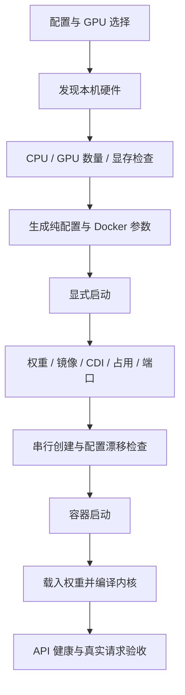

# 架构与设计逻辑

## 两端职责独立

GPU 服务器负责 Docker、CUDA、权重、镜像身份、GPU 分配和 vLLM。
BCM 负责 OpenCode、项目文件、Shell/Git/SSH 工具、用户凭据、历史和日志。
模型返回工具调用后，由 BCM 客户端以当前用户权限执行，再把结果交给模型。

必须分别确定三个配置，不能互相代替：

1. GPU 与模型策略：B300 TP4、GB300 TP4 或 GB300 TP2。
2. 服务端 CPU 与镜像平台：AMD64 或 ARM64。
3. 客户端程序：按 BCM 自身的 CPU 架构选择，不能由服务端 GPU 型号推断。

## 模块边界

| 模块 | 职责 |
|---|---|
| `profiles.py` / `profiles.json` | 硬件策略及纯粹的 vLLM 参数生成 |
| `server.py` | 发现硬件、生成计划、检查 GPU、管理实例 |
| `images.py` | 镜像平台与身份校验、模型下载、离线镜像传输 |
| `artifacts.py` | 客户端完整性与架构检查、公共资源导出 |
| `tunnel.py` | 单次连接拥有的本机 SSH 隧道、就绪检查和退出清理 |
| `client.py` | 用户私有状态、本地工具、连接配置和完整日志 |
| `installlog.py` | 安装步骤、实际命令、实时输出及失败诊断集中记录；只读操作无文件副作用 |
| `cli.py` | 解析参数并显式分派操作 |

导入模块不会启动进程。聊天操作不会隐式部署 GPU 服务。

## 服务端执行顺序

启动前将宿主机 GPU 编号解析成 UUID。CDI 只暴露选中的设备，
`CUDA_VISIBLE_DEVICES` 固定进程内的设备顺序。容器运行状态不能代替就绪检查。

实例配置摘要覆盖数据目录、镜像、平台、配置名、GPU UUID、API 端口和引擎参数。
同名实例不能静默采用不同配置或被编辑过的 `args.json`。
停止、删除、重建由操作者显式执行，宿主机日志保留，不会杀掉无关 GPU 进程。

## 镜像身份

平台配置固定多架构清单摘要，并记录各平台子摘要；本地镜像必须匹配服务端 CPU。
离线导出同时保存归档 SHA256 和镜像配置/层指纹，导入时两者都要通过。
仅有相同 tag 不足以证明镜像相同；指纹允许 Docker 导入后引用表示改变，但要求内容等价。

## 连接与用户状态

每次聊天拥有一个绑定在 `127.0.0.1` 的 SSH 转发进程。
认证和主机密钥校验使用现有 OpenSSH 配置；正常退出、启动失败或 Python 异常退出时关闭隧道。

历史按逻辑 SSH 目标及 SSH/API 端口，或直接 API 地址区分，不按临时转发端口区分，
因此重新连接不会丢失历史。每次连接使用独立配置文件，避免两个终端覆盖临时端口。
状态目录和配置权限分别为 0700、0600；系统管理员仍可访问。

API 保持本机监听，SSH 提供远程传输和接入控制。
当前不提供租户网关、用户配额或负载均衡。

## 性能配置的依据

B300 参考配置中，eager 与 CPU Engram 基线约为 5.2 token/s；
GPU 常驻 Engram 加解码 CUDA Graph 后，TP4 约为 222 token/s，TP8 单请求速度相近。
这是组合配置对比，不能分别归因于某项优化，也不能据此预测多人并发吞吐。

GB300 的主存和互联架构不同，TP2 按上游方式采用 CPU Engram offload。
B300 的速度不代表 GB300；GB300 配置仍等待实机验证。

## 安装准备的可观测性

cli.py 只为安装和部署操作建立 installlog.py 会话；common.run 在会话内记录实际子命令并实时收集输出，
会话外保持普通执行方式。进度写标准错误，JSON 结果写标准输出，已有自动化调用可以继续解析。
计划与查询不创建日志，也不因提供日志参数而失去只读性质。

镜像和模型准备先判断本地完整性与身份。完整材料直接复用；缺失缓存与内容冲突分别处理。
模型版本锁缺失时明确返回未验证状态，不伪造来源。完整内容哈希属于离线材料验收。
细节见[命令手册](commands.md)。

---

[English version](en/architecture.md)
