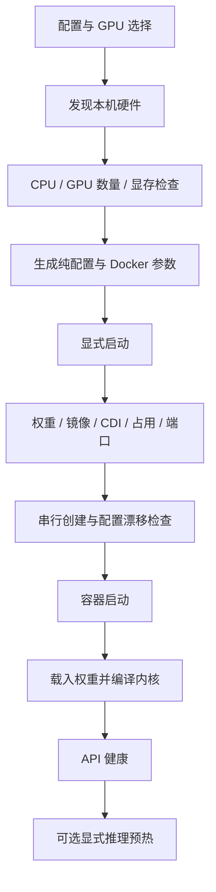

# 架构与设计逻辑

## v1.4.0 客户端任务链路

client.py 保留实际 endpoint 的历史键与恢复上下文；临时回环 API 观测器由 telemetry.py 管理。
它只转发到一个固定服务，不建立 SSH 隧道。observer.mjs 使用原生事件和压缩钩子，仅保存工具状态与计时元数据。
tasks.py 原子写入每次启动状态、监督客户端进程组，并为诊断提供中断/超时证据，不控制已提交的远端作业。
native_cache.py 仅复制匹配客户端身份的 SDK 依赖和锁文件，不复制旧连接配置；新会话仍使用隔离配置路径。
workflows.py 仅在显式 client workflow 时调用模型和工具，使用独立目录；普通查询不生成验收负载。
元数据源、缺失值和重叠计时的解释见[命令手册](commands.md#任务诊断与工作流回归v140)。

## 两端职责独立

GPU 服务器负责 Docker、CUDA、权重、镜像身份、GPU 分配和 vLLM。
BCM 负责 OpenCode、项目文件、Shell/Git/SSH 工具、用户凭据、历史和日志。
模型返回工具调用后，由 BCM 客户端以当前用户权限执行，再把结果交给模型。

必须分别确定三个配置，不能互相代替：

1. GPU 与模型策略：B300 TP4、B200 TP4（CPU/GPU Engram）、RTX 6000D TP8 或 GB300 TP4/TP2；各自验收范围独立。
2. 服务端 CPU 与镜像平台：AMD64 或 ARM64。
3. 客户端程序：按 BCM 自身的 CPU 架构选择，不能由服务端 GPU 型号推断。

## 模块边界

| 模块 | 职责 |
|---|---|
| `profiles.py` / `profiles.json` | 硬件策略及纯粹的 vLLM 参数生成 |
| `server.py` | 发现硬件、生成计划、检查 GPU、管理实例 |
| `images.py` | 镜像平台与身份校验、模型下载、离线镜像传输 |
| `artifacts.py` | 客户端完整性与架构检查、公共资源导出 |
| `endpoint.py` | HTTP(S) API 地址校验和模型就绪检查 |
| `readiness.py` | 端口与 HTTP 健康探测、启动等待、明确就绪日志；状态查询只读 |
| `warmup.py` | 显式有限推理预热、取消、进度与绑定容器启动时间的记录；状态查询不触发推理 |
| `benchmark.py` | 显式本机流式合成测试；分开记录预热与正式计时，校验 API token 数并保存配置及结果 |
| `client.py` | 用户私有状态、本地工具、连接配置和完整日志 |
| `installlog.py` | 安装步骤、实际命令、实时输出及失败诊断集中记录；只读操作无文件副作用 |
| `configuration.py` | 独立读写客户端默认值，不安装或连接服务 |
| `paths.py` / `program.py` | 可迁移路径与普通程序文件选择 |
| `deployment.py` / `bundle.py` | 就地准备角色资源、完整导出与清单校验 |
| `history.py` / `resume.py` / `operations.py` | 默认历史身份、原生会话恢复与通用任务指引 |
| `cli.py` | 解析参数并显式分派操作 |
| `completion.py` | 从 argparse 读取补全候选并生成 Bash 脚本；绕过业务分派与安装日志 |

导入模块不会启动进程。聊天操作不会隐式部署 GPU 服务。

## 服务端执行顺序

配方可声明 planning_only，并保留未知 image、platform_digest、min_vram_mib 为 null。
profiles.py 汇总阻塞项；框架计划保留硬件选择结果，但不生成引擎参数或 Docker 命令。
CLI 在日志之前拒绝部署/准备操作，底层入口也检查配方完整性。deployable=true 仅说明
配方可生成命令，不能替代 start 的实时资源检查或硬件验收。GB200/Rubin 边界见
[候选与框架](gb200-rubin.md)。现有实例 spec 和配置摘要不增加这些计划结果字段。

启动前将宿主机 GPU 编号解析成 UUID。CDI 只暴露选中的设备，
`CUDA_VISIBLE_DEVICES` 固定进程内的设备顺序。容器运行状态不能代替就绪检查。

实例配置摘要覆盖数据目录、镜像、平台、配置名、GPU UUID、API 端口和引擎参数。
同名实例不能静默采用不同配置或被编辑过的 `args.json`。
停止、删除、重建由操作者显式执行，宿主机日志保留，不会杀掉无关 GPU 进程。

## 网页与视频工具

client.py 仍启动一个 document_mcp 标准输入/输出子进程。documents.py 处理本地文档，webpage.py 按请求读取 HTTP(S) 正文，video.py 处理本地字幕和有限抽帧。启动和工具发现不请求外网；网页失败作为工具错误返回，后续本地调用独立。无搜索服务。FFmpeg 可选且不自动安装，模型推理职责不变。

## 镜像身份

平台配置固定多架构清单摘要，并记录各平台子摘要；准备机可保存其他架构镜像；部署时镜像必须匹配服务端 CPU。
离线导出同时保存归档 SHA256 和镜像配置/层指纹，导入时两者都要通过。
仅有相同 tag 不足以证明镜像相同；指纹允许 Docker 导入后引用表示改变，但要求内容等价。

客户端在隔离 XDG_CONFIG_HOME 前定位当前用户的个人 AGENTS.md，并在 operations.md 后通过 instructions 显式引用；v1.4.3 的客户端安装默认向同一用户路径应用通用模板，可选 BCM/英文或跳过。instructions.py 通过私有锁串行安装、修改前备份及原子替换，只更新管理区块并保留区块外内容；server、独立更新器和导出不应用个人规则。配置步骤见 [持久工作指令配置](../templates/opencode/agent-instructions.md)。

## 连接与用户状态

客户端只使用 --endpoint 连接 HTTP(S) 模型 API，不创建转发进程。BCM 到 API 的网络路径
由部署环境负责；nginx/frp 等外部工具可提供反向代理或转发，客户端只填写最终地址。
GPU 服务按示例监听 0.0.0.0，默认参数仍为 127.0.0.1；监听地址通过 --host 指定。

history.py 在用户状态根的 history-bindings.json 保存固定 active 历史身份，地址与程序安装目录不参与新身份计算；旧安装绑定可只读识别后升级。所有 endpoint 选择只改变 API 路由，connections 记录使用过的地址用于查询。独立 --state-dir 显式隔离历史；项目目录用于恢复工作位置。旧状态目录不改名、不复制数据库，兼容工具拒绝覆盖非空目标；元数据加锁、私有备份并在捕获写入失败时回滚。
每次连接使用独立配置文件；状态目录和配置权限分别为 0700、0600。旧版 SSH 历史目录
不会被删除，也不会自动迁移到 API 地址。系统管理员仍可访问用户文件。

当前不提供 API key/HTTPS、租户网关、用户配额或负载均衡；应限制可信网络访问。
工具可按任务需要使用 SSH，但这不参与模型 API 连接。

初次 install 可保存初始默认值；后续通过 config show/set/unset 或直接编辑 installation.json 配置 endpoint/model；chat 的显式参数只覆盖本次，不写回安装设置。每次连接的 API 检查与客户端配置均使用所选 endpoint，--check 返回 endpoint/model。切换到不同模型时显式指定 --model ID；不匹配直接失败，不回退。多个服务复用同一客户端程序。

思考档位由模型配方的 client.variants 声明，OpenCode 原生 Ctrl+T 在当前会话选择，并随下一条用户消息传到 HTTP 请求。normal 是空覆盖，沿用原行为；DeepSeek 档位显式携带 chat_template_kwargs，并禁用不兼容的 medium/minimal。它不改变服务端实例配置摘要、GPU 分配或 Engram 放置。

## 性能配置的依据

Engram 放置、CUDA Graph 等策略属于具体模型和硬件配方。GB300 主存与互联不同，须独立验收。具体测量值、方法和限制统一记录在[验证记录](validation.md)，优化路径、参数依据及 SGLang 探索保存在[性能探索记录](performance.md)。

预热完成记录绑定配置摘要与容器 StartedAt，重启后失效。API 就绪与推理预热分开表示；有限形状覆盖不保证后续没有 JIT。配方专属持久编译缓存属于本机实例，导出包不携带。

## 安装准备的可观测性

cli.py 只为安装和部署操作建立 installlog.py 会话；common.run 在会话内记录实际子命令并实时收集输出，
会话外保持普通执行方式。进度写标准错误，管理 JSON 写标准输出；批处理默认 text，事件解析显式加 --format json。
计划与查询不创建日志，也不因提供日志参数而失去只读性质。

镜像和模型准备先判断本地完整性与身份。完整材料直接复用；缺失缓存与内容冲突分别处理。
模型版本锁缺失时明确返回未验证状态，不伪造来源。完整内容哈希属于离线材料验收。
细节见[命令手册](commands.md)。

## 文档输入

client.prepare 将 document_mcp.py 注册为本机 stdio MCP 服务。documents.py 提取 Office/文字，并调用可选的宿主机 Poppler/LibreOffice。PDF 页面以图片内容送入模型，避免发送当前服务不支持的原始 PDF 附件。模型配方声明图片输入，工具进程使用客户端账户权限。无需改变 GPU 服务或增加 Python 依赖。格式与读取边界见[富文档指南](documents.md)。

## 程序更新边界

scripts/update.py 是独立标准库脚本，不导入待替换的旧程序模块。它只替换明确列出的源码路径，保留资源与配置，备份旧程序和安装元数据，并使旧离线包校验记录失效；不调用 install、Docker、模型/客户端下载或服务重启。备份在安装根之外；普通导出包含 scripts/，因此保留的引导更新脚本也可携带。

## 跨平台介质准备

preparation.py 编排目标镜像拉取、模型下载和镜像归档；hub.py 使用标准库 HTTP 获取固定模型提交，校验 Git blob/LFS 内容标识并支持断点续传。prepare 不执行目标程序、不探测 GPU、不修改 installation.json；export 显式选择目标配方。安装与启动仍按目标主机架构和真实硬件验收。旧 model download 保留原生容器路径。

## 可迁移安装目录

完整程序、模型、镜像归档和公共客户端保留在解压目录；默认路径随程序位置变化。install 准备资源，server start 创建本机实例。export 写入 dist/ 并包含相对路径校验清单；新目录中 install --offline 校验并导入。dist/ 自身、旧实例、个人历史和凭据排除。公共客户端仅含程序和公共缓存，个人状态仍隔离。

---

[English version](en/architecture.md)

## 执行与会话迁移（v2.0.0）

client.prepare 加载 observer.mjs 和逐次复制的 execution.mjs，复用原生 SDK，不需独立 Node。插件绑定实际项目/会话身份，请求原生权限，以暂停门控制新工具，并在项目迁移后显式提供当前目录。普通交互 Bash 较长时自动托管；按命令匹配权限或 --sync-bash 保留原生解析器，批处理始终同步。

execution.py 管理私有记录、锁、稳定操作/输入键、PTY 与核验后的 Linux 进程组；显式 adopt 只接管自有组长。adapters.py 以独立代码副本控制 SSH、Slurm 和带标签容器。未知提交按身份找回，不重新提交；取消须确认后端状态。

插件租用完成通知、使用固定消息 ID、验证持久化后确认投递；忙碌/暂停/暂缓时延后。退出聊天不停止任务，重启机器不重放。进程控制不是沙箱，主动脱离组的后代不在保证范围内。 v2.1.3 在任务元数据 notification.read 中保存连续输出游标与终态签名；已读完的结果只发 toast 并确认通知，不写会话或调用模型。旧状态从最近 100 条原生工具消息补查。

batch.py 读取单个 UTF-8 提示并把原生事件转换为文本，tasks.py 保留私有原始事件和退出语义；workflows.py 显式选择 JSON。portability.py 使用 SQLite 快照、哈希私有 ZIP、独立导入及目录映射，不改原生数据库结构、不迁移任务。diagnostics.py 汇总元数据与请求观测，不带对话正文。历史/执行状态按用户管理、独立于 endpoint，工作仍按项目路径隔离。

详细边界和示例见[执行](execution.md)、[批处理与迁移](automation.md)。

v2.0.1 增加逐任务恢复锁/监控锁，按身份重新接管且不重提；保留确认终态，以 result.log 缓存有界连续输出并明确完整/部分覆盖。独立控制器尽力收集结果，doctor 提示控制器缺失。仅 chat 叶解析器使用标准 argparse 混排；个人规则迁移仅删除精确模板副本，保留备份、代码块和定制文字。
