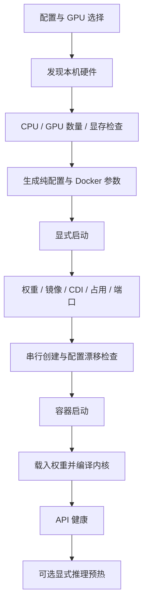

# 架构与设计逻辑

## 两端职责独立

GPU 服务器负责 Docker、CUDA、权重、镜像身份、GPU 分配和 vLLM。
BCM 负责 OpenCode、项目文件、Shell/Git/SSH 工具、用户凭据、历史和日志。
模型返回工具调用后，由 BCM 客户端以当前用户权限执行，再把结果交给模型。

必须分别确定三个配置，不能互相代替：

1. GPU 与模型策略：B300 TP4、GB300 TP4 或 GB300 TP2。
2. 服务端 CPU 与镜像平台：AMD64 或 ARM64。
3. 客户端程序：按 BCM 自身的 CPU 架构选择，不能由服务端 GPU 型号推断。

## 模块边界

| 模块 | 职责 |
|---|---|
| `profiles.py` / `profiles.json` | 硬件策略及纯粹的 vLLM 参数生成 |
| `server.py` | 发现硬件、生成计划、检查 GPU、管理实例 |
| `images.py` | 镜像平台与身份校验、模型下载、离线镜像传输 |
| `artifacts.py` | 客户端完整性与架构检查、公共资源导出 |
| `endpoint.py` | HTTP(S) API 地址校验和模型就绪检查 |
| `readiness.py` | 端口与 HTTP 健康探测、启动等待、明确就绪日志；状态查询只读 |
| `warmup.py` | 显式有限推理预热、取消、进度与绑定容器启动时间的记录；状态查询不触发推理 |
| `client.py` | 用户私有状态、本地工具、连接配置和完整日志 |
| `installlog.py` | 安装步骤、实际命令、实时输出及失败诊断集中记录；只读操作无文件副作用 |
| `configuration.py` | 独立读写客户端默认值，不安装或连接服务 |
| `paths.py` / `program.py` | 可迁移路径与普通程序文件选择 |
| `deployment.py` / `bundle.py` | 就地准备角色资源、完整导出与清单校验 |
| `resume.py` / `operations.py` | 原生会话恢复与通用任务指引 |
| `cli.py` | 解析参数并显式分派操作 |

导入模块不会启动进程。聊天操作不会隐式部署 GPU 服务。

## 服务端执行顺序

启动前将宿主机 GPU 编号解析成 UUID。CDI 只暴露选中的设备，
`CUDA_VISIBLE_DEVICES` 固定进程内的设备顺序。容器运行状态不能代替就绪检查。

实例配置摘要覆盖数据目录、镜像、平台、配置名、GPU UUID、API 端口和引擎参数。
同名实例不能静默采用不同配置或被编辑过的 `args.json`。
停止、删除、重建由操作者显式执行，宿主机日志保留，不会杀掉无关 GPU 进程。

## 镜像身份

平台配置固定多架构清单摘要，并记录各平台子摘要；本地镜像必须匹配服务端 CPU。
离线导出同时保存归档 SHA256 和镜像配置/层指纹，导入时两者都要通过。
仅有相同 tag 不足以证明镜像相同；指纹允许 Docker 导入后引用表示改变，但要求内容等价。

## 连接与用户状态

客户端只使用 --endpoint 连接 HTTP(S) 模型 API，不创建转发进程。BCM 到 API 的网络路径
由部署环境负责；nginx/frp 等外部工具可提供反向代理或转发，客户端只填写最终地址。
GPU 服务按示例监听 0.0.0.0，默认参数仍为 127.0.0.1；监听地址通过 --host 指定。

历史按规范化后的 API endpoint 区分，末尾斜杠不影响身份。不同主机或端口使用独立历史。
每次连接使用独立配置文件；状态目录和配置权限分别为 0700、0600。旧版 SSH 历史目录
不会被删除，也不会自动迁移到 API 地址。系统管理员仍可访问用户文件。

当前不提供 API key/HTTPS、租户网关、用户配额或负载均衡；应限制可信网络访问。
工具可按任务需要使用 SSH，但这不参与模型 API 连接。

初次 install 可保存初始默认值；后续通过 config show/set/unset 或直接编辑 installation.json 配置 endpoint/model；chat 的显式参数只覆盖本次，不写回安装设置。每次连接的 API 检查与客户端配置均使用所选 endpoint，--check 返回 endpoint/model。切换到不同模型时显式指定 --model ID；不匹配直接失败，不回退。多个服务复用同一客户端程序。

思考档位由模型配方的 client.variants 声明，OpenCode 原生 Ctrl+T 在当前会话选择，并随下一条用户消息传到 HTTP 请求。default 是空覆盖，沿用原行为；DeepSeek 档位显式携带 chat_template_kwargs，并禁用不兼容的 medium/minimal。它不改变服务端实例配置摘要、GPU 分配或 Engram 放置。

## 性能配置的依据

Engram 放置、CUDA Graph 等策略属于具体模型和硬件配方。GB300 主存与互联不同，须独立验收。具体测量值、方法和限制统一记录在[验证记录](validation.md)，优化路径、参数依据及 SGLang 探索保存在[性能探索记录](performance.md)。

预热完成记录绑定配置摘要与容器 StartedAt，重启后失效。API 就绪与推理预热分开表示；有限形状覆盖不保证后续没有 JIT。配方专属持久编译缓存属于本机实例，导出包不携带。

## 安装准备的可观测性

cli.py 只为安装和部署操作建立 installlog.py 会话；common.run 在会话内记录实际子命令并实时收集输出，
会话外保持普通执行方式。进度写标准错误，JSON 结果写标准输出，已有自动化调用可以继续解析。
计划与查询不创建日志，也不因提供日志参数而失去只读性质。

镜像和模型准备先判断本地完整性与身份。完整材料直接复用；缺失缓存与内容冲突分别处理。
模型版本锁缺失时明确返回未验证状态，不伪造来源。完整内容哈希属于离线材料验收。
细节见[命令手册](commands.md)。

## 文档输入

client.prepare 将 document_mcp.py 注册为本机 stdio MCP 服务。documents.py 提取 Office/文字，并调用可选的宿主机 Poppler/LibreOffice。PDF 页面以图片内容送入模型，避免发送当前服务不支持的原始 PDF 附件。模型配方声明图片输入，工具进程使用客户端账户权限。无需改变 GPU 服务或增加 Python 依赖。格式与读取边界见[富文档指南](documents.md)。

## 程序更新边界

scripts/update.py 是独立标准库脚本，不导入待替换的旧程序模块。它只替换明确列出的源码路径，保留资源与配置，备份旧程序和安装元数据，并使旧离线包校验记录失效；不调用 install、Docker、模型/客户端下载或服务重启。备份在安装根之外；普通导出包含 scripts/，因此保留的引导更新脚本也可携带。

## 可迁移安装目录

完整程序、模型、镜像归档和公共客户端保留在解压目录；默认路径随程序位置变化。install 准备资源，server start 创建本机实例。export 写入 dist/ 并包含相对路径校验清单；新目录中 install --offline 校验并导入。dist/ 自身、旧实例、个人历史和凭据排除。公共客户端仅含程序和公共缓存，个人状态仍隔离。

---

[English version](en/architecture.md)
