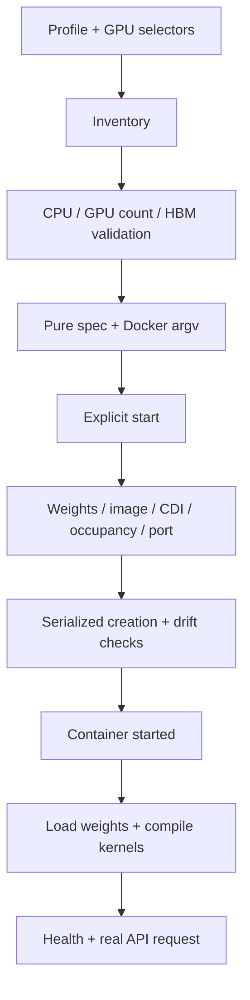

# Architecture and design decisions

[中文（默认）](../architecture.md)

## Roles are independent

The GPU host owns Docker, CUDA, weights, image provenance, GPU allocation and
vLLM. BCM owns OpenCode, project files, shell/git/SSH tools, user credentials,
history and transcripts. Tool calls returned by the model are executed on BCM
with the current user's permissions.

These identities are independent:
1. GPU/model policy: B300 TP4, GB300 TP4 or GB300 TP2.
2. Server CPU/image platform: AMD64 or ARM64.
3. Client binary: selected from the BCM host CPU, never from the GPU profile.

## Module boundaries

| Module | Responsibility |
|---|---|
| profiles.py / profiles.json | Hardware policy; pure vLLM argument generation |
| server.py | Inventory, plans, selected-GPU checks and instance lifecycle |
| images.py | Image platform/provenance, model download, offline image transport |
| artifacts.py | Native client integrity/architecture and public asset exports |
| tunnel.py | Owned loopback SSH forward, startup checks and cleanup |
| client.py | Private user state, local tools, config and full transcripts |
| cli.py | Explicit role/operation dispatch |

No module launches a process at import. Chat never invokes GPU deployment.

## Server flow

Host GPU indices resolve to UUIDs before launch. CDI exposes only selected GPUs;
CUDA_VISIBLE_DEVICES fixes local ordering. A container being running is not a
readiness signal.

The managed spec hash covers runtime location, image, platform, profile, GPU
UUIDs, API port and engine arguments. Existing instances cannot silently adopt
different specs or edited args.json. Stop/remove/recreate is explicit and
retains host logs. Unrelated GPU processes are never killed.

## Image identity

Profiles pin a manifest-list digest and record platform child digests.
Locally selected images must match the server CPU architecture.
Offline exports carry archive SHA256 plus the image's config/layer fingerprint.
Imports require both checks; a mutable tag alone cannot establish identity.
The fingerprint permits equivalent content after Docker export/import changes
the local image-reference representation.

## Connection and user state

Each chat invocation owns one SSH forward bound to 127.0.0.1. Authentication
and host-key verification use existing OpenSSH configuration. The process is
closed on normal exit, startup failure and Python exception unwinding.

History is keyed by logical SSH target and SSH/API ports, or the direct endpoint.
It is not keyed by the temporary forwarding port, so reconnecting preserves
history. Each invocation has a separate config file so two sessions cannot
overwrite one another's temporary port. State/config use 0700/0600; OS
administrators can still access them.

The API remains loopback-only. SSH provides remote transport/access control.
This is not a tenant gateway, per-user quota engine or load balancer.

## Performance policy

The B300 reference's eager/CPU-offload baseline decoded about 5.2 tokens/s.
GPU-resident Engram plus decode CUDA Graphs reached about 222 tokens/s at TP4;
TP8 was comparable for one request. This combined-profile comparison does not
isolate each optimization's contribution or predict concurrent-user throughput.

GB300 has a different host-memory/interconnect architecture. Its TP2 profile
intentionally uses upstream-style CPU Engram offload. B300 speed is not a GB300
performance claim. GB300 profiles remain unverified on hardware.
