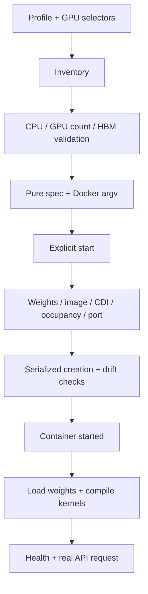

# Architecture and design decisions

[中文（默认）](../architecture.md)

## Roles are independent

The GPU host owns Docker, CUDA, weights, image provenance, GPU allocation and
vLLM. BCM owns OpenCode, project files, shell/git/SSH tools, user credentials,
history and transcripts. Tool calls returned by the model are executed on BCM
with the current user's permissions.

These identities are independent:
1. GPU/model policy: B300 TP4, GB300 TP4 or GB300 TP2.
2. Server CPU/image platform: AMD64 or ARM64.
3. Client binary: selected from the BCM host CPU, never from the GPU profile.

## Module boundaries

| Module | Responsibility |
|---|---|
| profiles.py / profiles.json | Hardware policy; pure vLLM argument generation |
| server.py | Inventory, plans, selected-GPU checks and instance lifecycle |
| images.py | Image platform/provenance, model download, offline image transport |
| artifacts.py | Native client integrity/architecture and public asset exports |
| endpoint.py | HTTP(S) API address validation and model readiness checks |
| readiness.py | Port/HTTP health probes, startup waiting and explicit runtime-log readiness; status is read-only |
| client.py | Private user state, local tools, config and full transcripts |
| cli.py | Explicit role/operation dispatch |

No module launches a process at import. Chat never invokes GPU deployment.

## Server flow

Host GPU indices resolve to UUIDs before launch. CDI exposes only selected GPUs;
CUDA_VISIBLE_DEVICES fixes local ordering. A container being running is not a
readiness signal.

The managed spec hash covers runtime location, image, platform, profile, GPU
UUIDs, API port and engine arguments. Existing instances cannot silently adopt
different specs or edited args.json. Stop/remove/recreate is explicit and
retains host logs. Unrelated GPU processes are never killed.

## Image identity

Profiles pin a manifest-list digest and record platform child digests.
Locally selected images must match the server CPU architecture.
Offline exports carry archive SHA256 plus the image's config/layer fingerprint.
Imports require both checks; a mutable tag alone cannot establish identity.
The fingerprint permits equivalent content after Docker export/import changes
the local image-reference representation.

## Connection and user state

Clients connect only through --endpoint to an HTTP(S) model API and create no forwarding
processes. The environment supplies the network path; administrators may configure nginx/frp
or other forwarding externally. Examples use --host 0.0.0.0; the parameter default remains
127.0.0.1 for local access or an administrator-managed proxy.

History is keyed by normalized endpoint, ignoring trailing slashes. Different hosts/ports
have separate histories and every invocation has independent configuration. State directories
and files use 0700/0600. Old SSH-keyed histories remain untouched and are not auto-migrated.
Administrators can still access user data.

API keys/HTTPS, tenant gateways, quotas and load balancing are not configured. Restrict
network access. Tools may use SSH for onward tasks, independently of inference transport.

## Performance policy

The B300 reference's eager/CPU-offload baseline decoded about 5.2 tokens/s.
GPU-resident Engram plus decode CUDA Graphs reached about 222 tokens/s at TP4;
TP8 was comparable for one request. This combined-profile comparison does not
isolate each optimization's contribution or predict concurrent-user throughput.

GB300 has a different host-memory/interconnect architecture. Its TP2 profile
intentionally uses upstream-style CPU Engram offload. B300 speed is not a GB300
performance claim. GB300 profiles remain unverified on hardware.

## Installation observability

cli.py establishes an installlog.py session only for installation/deployment actions. Within that session,
common.run records actual subprocess commands and streams their output; outside it, execution remains ordinary.
Progress uses stderr and JSON results use stdout, preserving automation contracts. Plans and queries create no
journal, including when a journal path is supplied.

Image/model preparation checks local completeness and identity before network work. Reusable artifacts skip
downloads; absent caches and conflicting content are distinct outcomes. Missing model provenance is reported
as unverified rather than fabricated. Complete content hashes belong to offline artifact acceptance.
See the [command manual](commands.md).

## Portable installation directory

The unpacked root retains complete program, models, image archives and public clients. Defaults follow its location. install prepares assets; server start creates host-local instances. export writes dist/ with relative checksums; install --offline verifies/imports after extraction elsewhere. Exclude dist/ itself, old instances, histories and credentials. Public clients contain only binaries/public cache; personal state stays isolated.
